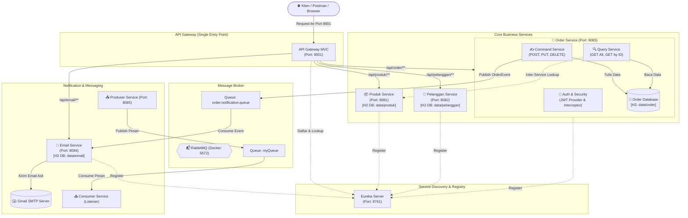

# 🏛️ Arsitektur Berorientasi Layanan (ABL) - Microservices E-Commerce & Order System

**Mata Kuliah:** Arsitektur Berorientasi Layanan (ABL)  
**Mahasiswa:** Naufal Khalil Aldeza  
**NIM:** 2411083014  
**Semester:** 5  

---

## 📖 Ringkasan Proyek

Repositori ini mengimplementasikan sistem **Enterprise Microservices** berbasis **Spring Boot**, **Spring Cloud**, **RabbitMQ Message Broker**, dan **Event-Driven Architecture**.

Sistem ini mengadopsi pola modern arsitektur perangkat lunak:
1. **CQRS (Command Query Responsibility Segregation)** pada layanan *Order*, memisahkan alur pengubahan data (*Command/Write*) dan alur pembacaan data (*Query/Read*).
2. **Event-Driven Asynchronous Notification** menggunakan **RabbitMQ**, di mana pembuatan order secara otomatis memicu pengiriman email konfirmasi transaksi asli ke pelanggan via **Gmail SMTP**.
3. **API Gateway & Service Discovery**, menggunakan **Spring Cloud Gateway MVC** sebagai pintu gerbang tunggal (*Single Entry Point*) dan **Eureka Server** sebagai service registry.
4. **Keamanan Autentikasi JWT (JSON Web Token)** untuk memproteksi operasi transaksional pada *Command Service*.

---

## 📐 Diagram Arsitektur Sistem

Berikut visualisasi menyeluruh dari interaksi antar layanan:



---

## 🗂️ Rincian Microservices

| Service | Port | Database | Deskripsi & Tanggung Jawab |
|---|---|---|---|
| **`eureka`** | `8761` | - | Service Registry & Discovery untuk pendaftaran dinamis seluruh instance microservice. |
| **`gateway`** | `9001` | - | Reverse proxy tunggal menggunakan Spring Cloud Gateway MVC untuk merouting request ke service internal. |
| **`produk`** | `8081` | H2 File | CRUD katalog produk dan master kategori jenis barang. |
| **`pelanggan`** | `8082` | H2 File | CRUD master data pelanggan. |
| **`order`** | `8083` | H2 File | Pengelolaan transaksi pesanan menerapkan pola **CQRS** dan autentikasi **JWT**. |
| **`email`** | `8084` | H2 File | Consumer event RabbitMQ yang otomatis mengirim email notifikasi resmi via Gmail SMTP. |
| **`produser`** | `8085` | - | Modul praktikum pengiriman pesan string ke RabbitMQ (`myQueue`). |
| **`consumer`** | Background | - | Modul praktikum penerima pesan dari queue RabbitMQ. |

---

## 🔄 Alur Kerja Sistem (Workflow Sesuai Desain Papan Tulis)

### 1. Pola CQRS (Command Query Responsibility Segregation)
- **Command (Jalur Tulis):**
  - Menerima request modifikasi (`POST`, `PUT`, `DELETE`).
  - Mengotentikasi token JWT klien.
  - Menyimpan transaksi ke Database Order.
  - Mengirimkan event `OrderEvent` ke queue RabbitMQ (`order.notification.queue`).
- **Query (Jalur Baca):**
  - Menerima request pembacaan data (`GET /api/order` atau `GET /api/order/{id}`).
  - Membaca data langsung dari Database Order.
  - Untuk detail order, service melakukan *API Composition* dengan mengambil informasi produk dari **Produk Service** melalui Eureka Discovery.

### 2. Alur Event-Driven Notifikasi Email
```
[POST /api/order] ──> Order Command Service
                            │
                            ├──> Simpan ke DB Order
                            └──> Publish OrderEvent ke RabbitMQ
                                      │
                                      ▼
                                [RabbitMQ Broker]
                                      │ (Consume)
                                      ▼
                                [Email Service]
                                      │
                                      ├──> Kirim Email Real-time via Gmail SMTP
                                      └──> Simpan Riwayat Log ke DB Email
```

---

## 🚀 Panduan Menjalankan Sistem

### 1. Prasyarat Lingkungan
- **Java Development Kit (JDK):** Versi 25 (atau minimal JDK 17+)
- **Docker Desktop:** Untuk menjalankan RabbitMQ Message Broker
- **Git**

### 2. Jalankan Message Broker RabbitMQ
Buka terminal dan jalankan container RabbitMQ dengan antarmuka manajemen:
```powershell
docker run -d --name rabbitmq -p 5672:5672 -p 15672:15672 rabbitmq:3-management
```
> Antarmuka web RabbitMQ dapat diakses di: `http://localhost:15672` (Username: `guest`, Password: `guest`).

### 3. Konfigurasi Environment Variable
Salin file `.env.example` menjadi `.env` di root direktori dan sesuaikan:
```powershell
cp .env.example .env
```
Isi variabel dengan kredensial Gmail App Password (16 karakter tanpa spasi):
```properties
GMAIL_USERNAME=emailanda@gmail.com
GMAIL_APP_PASSWORD=abcdefghijklmnop
EMAIL_PENERIMA=emailanda@gmail.com
```

### 4. Urutan Menjalankan Microservices
Jalankan aplikasi dari IDE (VS Code / IntelliJ) atau via Maven wrapper dengan urutan:
1. `eureka/eureka` (`EurekaApplication.java`) ➔ Tunggu hingga port `8761` aktif.
2. `produk/produk` (`ProdukApplication.java`) ➔ Port `8081`.
3. `pelanggan/pelanggan` (`PelangganApplication.java`) ➔ Port `8082`.
4. `order/order` (`OrderApplication.java`) ➔ Port `8083`.
5. `email/email` (`EmailApplication.java`) ➔ Port `8084`.
6. `produser` (`ProduserApplication.java`) ➔ Port `8085`.
7. `gateway/gateway` (`GatewayApplication.java`) ➔ Port `9001`.

Verifikasi seluruh service telah terdaftar di Eureka Dashboard: **`http://localhost:8761`**.

---

## 🧪 Panduan Pengujian API (via Gateway Port 9001)

Seluruh pengujian dilakukan melalui API Gateway di port **`9001`**.

### 1. Autentikasi Pengguna (JWT)
#### A. Registrasi
- **URL:** `POST http://localhost:9001/api/order/auth/register`
- **Body (JSON):**
  ```json
  {
    "username": "naufal",
    "password": "password123",
    "nama": "Naufal Khalil",
    "role": "USER"
  }
  ```

#### B. Login (Dapatkan Token JWT)
- **URL:** `POST http://localhost:9001/api/order/auth/login`
- **Body (JSON):**
  ```json
  {
    "username": "naufal",
    "password": "password123"
  }
  ```
- **Response:** Salin nilai `token` dari respons JSON.

---

### 2. Persiapan Master Data Produk & Pelanggan
#### A. Tambah Jenis Barang
- **URL:** `POST http://localhost:9001/api/produk/jenis-barang`
- **Body (JSON):**
  ```json
  {
    "namaJenis": "Elektronik",
    "deskripsi": "Perangkat elektronik komputer"
  }
  ```

#### B. Tambah Produk
- **URL:** `POST http://localhost:9001/api/produk`
- **Body (JSON):**
  ```json
  {
    "nama": "Laptop ASUS ROG",
    "harga": 20000000,
    "jenisBarangId": 1
  }
  ```

#### C. Tambah Pelanggan
- **URL:** `POST http://localhost:9001/api/pelanggan`
- **Body (JSON):**
  ```json
  {
    "nama": "Naufal",
    "alamat": "Padang",
    "jenisKelamin": "Laki-laki"
  }
  ```

---

### 3. Eksekusi Order (CQRS Command & Trigger Notifikasi Email)
- **URL:** `POST http://localhost:9001/api/order`
- **Headers:**
  - `Content-Type: application/json`
  - `Authorization: Bearer <TOKEN_JWT_DARI_LOGIN>`
- **Body (JSON):**
  ```json
  {
    "produkId": 1,
    "pelangganId": 1,
    "tglTransaksi": "2026-10-29",
    "jumlah": 1,
    "total": 20000000.0
  }
  ```
- **Hasil:**
  - Order tersimpan di database Order.
  - RabbitMQ meneruskan event ke Email Service.
  - Email konfirmasi pesanan masuk ke kotak masuk Gmail penerima.
  - Log pengiriman email dapat diperiksa di `GET http://localhost:9001/api/email`.

---

### 4. Pembacaan Order (CQRS Query)
- **URL:** `GET http://localhost:9001/api/order/1`
- **Hasil:** Mengembalikan data order lengkap yang digabungkan dengan detail produk dari Produk Service.

---

## 📚 Dokumentasi Lanjutan
- [Alur Detail & Mermaid Workflow](file:///c:/Users/Nopal/OneDrive/Documents/KULIAH/semester%205/ABL/docs/workflow.md)
- [Panduan Git & Instruksi Handoff Agent](file:///c:/Users/Nopal/OneDrive/Documents/KULIAH/semester%205/ABL/docs/git_and_agent_guide.md)
