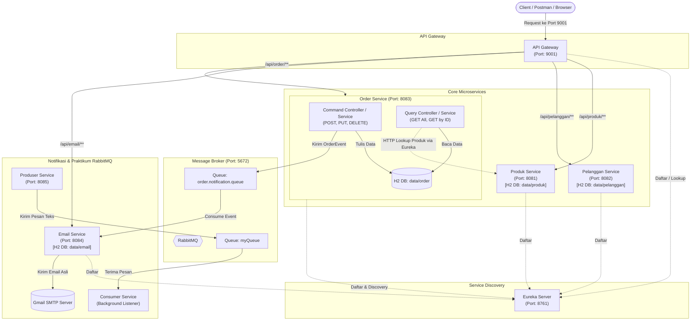

---

## Alur Autentikasi (JWT) pada Order Service

### 1. Registrasi Akun
* **Endpoint:** `POST /api/order/auth/register` (atau via Gateway: `http://localhost:9001/api/order/auth/register`)
* **Payload:**
  ```json
  {
    "username": "naufal",
    "password": "rahasia123",
    "nama": "Naufal",
    "role": "USER"
  }
  ```
* **Respons:** HTTP `201 Created` berisi data akun dan token JWT.

---

### 2. Login & Penerbitan Token
* **Endpoint:** `POST /api/order/auth/login` (atau via Gateway: `http://localhost:9001/api/order/auth/login`)
* **Payload:**
  ```json
  {
    "username": "naufal",
    "password": "rahasia123"
  }
  ```
* **Respons:** HTTP `200 OK` berisi token JWT:
  ```json
  {
    "token": "eyJhbGciOiJIUzM4NCJ9...",
    "type": "Bearer",
    "username": "naufal",
    "nama": "Naufal",
    "role": "USER",
    "message": "Login berhasil!"
  }
  ```

---

### 3. Akses Terproteksi (Command CQRS)
Untuk membuat order baru (`POST /api/order`), mengupdate (`PUT`), atau menghapus (`DELETE`), sertakan token di header HTTP:
* **Header:** `Authorization: Bearer <token_jwt>`
* Jika token tidak disertakan atau kedaluwarsa, sistem otomatis menolak dengan kode **`401 Unauthorized`**.
